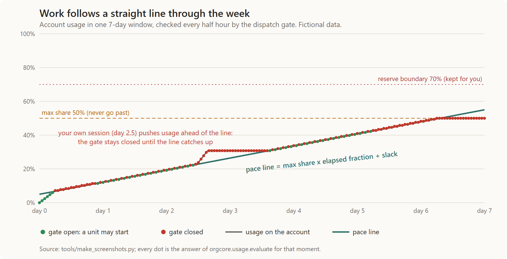
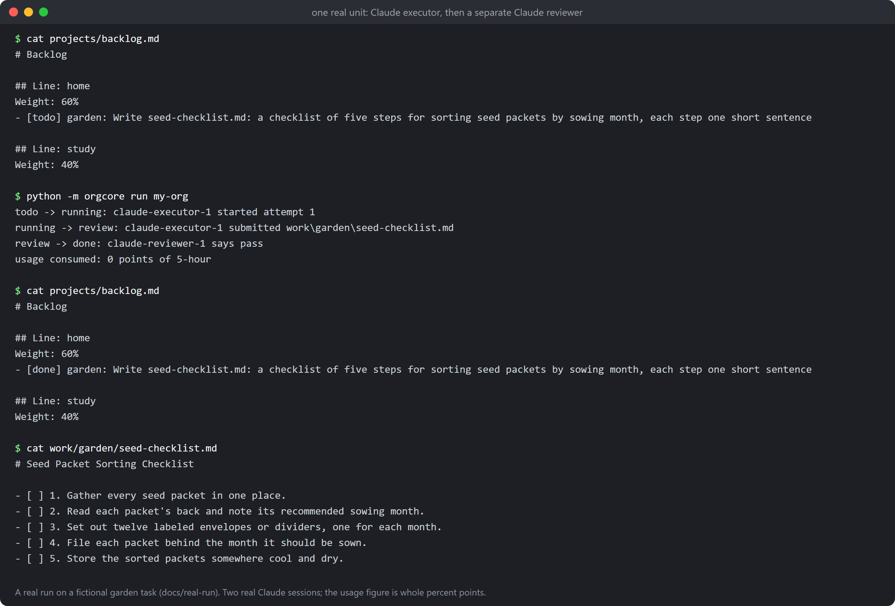
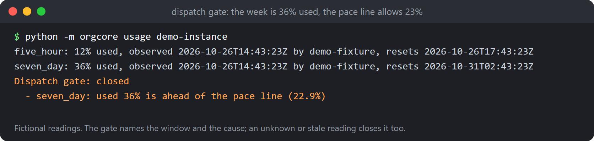
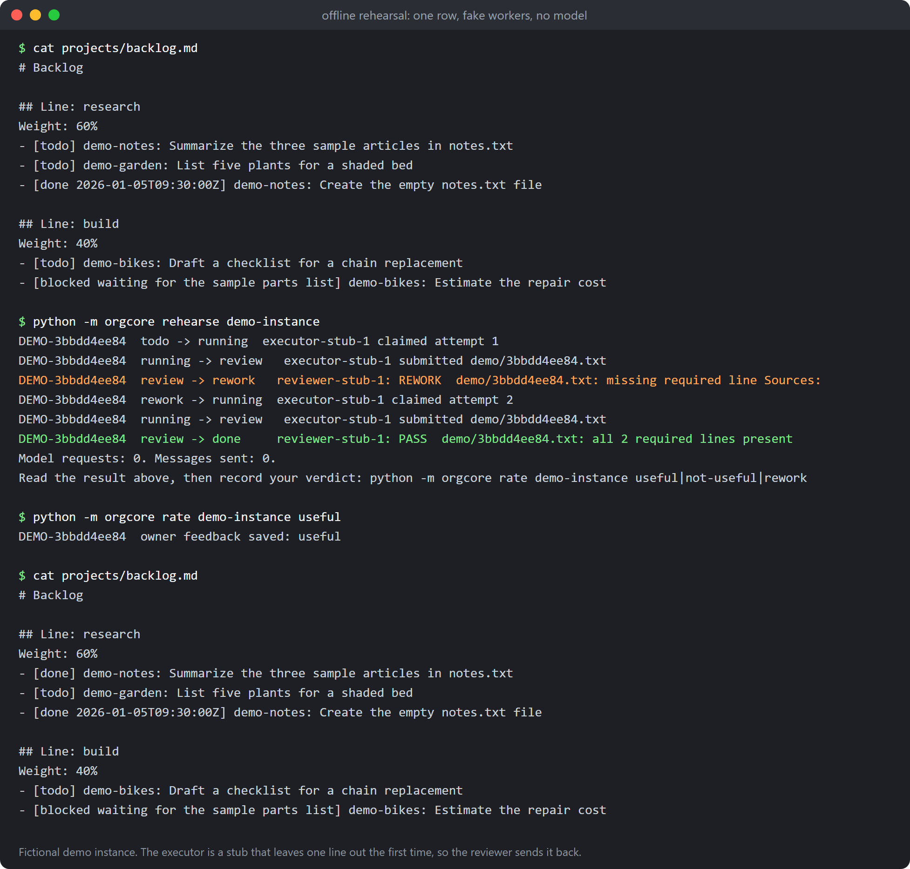

# 你需要一个总理 (You need a premier)

**For people whose ideas outrun their capacity to execute.** You say what you intend. A coordinator (the "premier", 总理) takes that intent, hands work to AI agents, and pushes it forward relentlessly, pacing itself against whatever subscription usage you have left, and never touching the share you keep for yourself.

It is a small, text-first core: a plain-text task board, a coordinator-led setup run in the official Claude Code CLI, executors and reviewers kept apart, and a dispatch gate that reads your real usage. Python 3.11+, standard library only. It runs on your own subscription sign-in; it never asks for an API key and never spends money.



*One 7-day window. The straight line is the pace the organization allows itself; the markers are the dispatch gate's decisions (green: a unit may start, red: closed). When your own session pushes usage ahead of the line, work pauses until the line catches up. Fictional data; generated by `tools/make_screenshots.py`.*

Status: v0.1 in progress. Real work runs one unit at a time on your command (`python -m orgcore run`); a loop that keeps going unattended is not in this version. Reports stay local files.

## A real run

Everything above the line was first shown with stub workers, so here is one real unit. On 2026-10-26, on a fictional instance (a "garden" project, set up through the guided setup), the row "Write seed-checklist.md: a checklist of five steps for sorting seed packets by sowing month, each step one short sentence" was run with `python -m orgcore run` on a Claude Enterprise sign-in. No API key, no money.



- **What it produced:** `seed-checklist.md`, five numbered steps, one short sentence each (`docs/real-run/seed-checklist.md`).
- **What the reviewer said:** `pass`, from a separate session with its own identity. It checked the five steps and the one-sentence rule against the row, found no credential, spending or outside claim, and left one small follow-up (step 5, storing the packets, comes after the sort is finished). A trivial task, so there was nothing for the reviewer to catch; an example where it sends work back is the offline rehearsal below.
- **How much allowance it used:** the whole unit, executor and reviewer, took about 20 seconds, and the 5-hour window read 1% used before and 1% after. The status data reports whole percent points, so the run is recorded as "0 points, measured"; the cost is somewhere under one point. Larger tasks will show a larger figure.
- **Files:** `docs/real-run/` has the board before and after, the command output and the produced file; `tools/make_screenshots.py` draws the picture from them.

This is one small task, not evidence about quality on real work.

## What is different

Every item below is implemented and has tests; the file names point at the code, the tests and, where there is one, the format description.

**Setup is a conversation, not a form.** `python bootstrap.py` checks the machine, asks for consent, and opens the official Claude Code CLI with the coordinator's setup prompt. The coordinator asks one question at a time and saves every validated answer as a file, so setup can stop and continue at any time and never depends on a chat history. Files: `bootstrap.py`, `orgcore/setup.py`, `prompts/setup-coordinator.md`, `docs/guided-setup.md`; tests: `tests/test_setup.py`, `tests/test_bootstrap.py`.

**The task board is a text file.** One Markdown file in which every task is a row tagged with its state (`todo`, `running`, `review`, `rework`, `done`, `blocked`), readable and editable by people and agents alike. Cross-process locks and atomic writes keep concurrent updates safe; a worker that dies leaves a row that is put back only when its claim lock is really gone. Files: `orgcore/backlog.py`, `orgcore/fsio.py`, `docs/backlog-format.md`; tests: `tests/test_backlog.py`, `tests/test_workflow.py`.

**Executors cannot grade their own work.** An executor can only move a row to review; a reviewer with its own identity and session issues `pass`, `rework` or `blocked` with evidence, and an identity that executed an attempt is refused as its reviewer. Files: `orgcore/workflow.py`, `docs/scheduling.md`; tests: `tests/test_workflow.py`, `tests/test_adapter.py`.

**Dispatch follows your subscription, not a timer.** Before every dispatch the gate checks each usage window: an unknown, stale or already-reset reading closes it (unknown is never treated as zero), as do your reserve and a maximum share per window. Readings come from the official CLI's own status data; nothing is polled and no model is called to measure. Files: `orgcore/usage.py`, `orgcore/statusline.py`, `usage_hook.py`, `docs/real-workers.md`; tests: `tests/test_usage.py`, `tests/test_real_usage.py`.



**The pace line.** Optionally a window can declare `length_hours` and `pacing_slack_percent`; the gate then also blocks when usage is ahead of `max share x elapsed fraction + slack`, so work is spread along the week instead of burning the allowance on day one, and the pause is lifted by itself as the line catches up. It is off until you add those two fields to a window in `policy.json`. Files: `orgcore/usage.py` (`evaluate`), `orgcore/config.py`, `docs/scheduling.md`; test: `tests/test_usage.py` (pacing).

**Lines share the allowance by weight.** The next row comes from the line with the lowest `(usage its runs consumed in the last 7 days + a typical run) / weight`; each run's cost is measured from the usage reading before and after, and a run that could not be measured is charged an average, never zero. Files: `orgcore/scheduler.py`, `docs/scheduling.md`; test: `tests/test_scheduler.py`.

**Real execution is opt-in, one project and one task at a time.** `enable-live` first shows what would be handed to the model (project, folder, task, your reserve lines) and writes the consent only after you type `yes`. Files: `orgcore/live.py`, `docs/real-workers.md`; test: `tests/test_live.py`.

**Workers are boxed in.** The executor gets file tools in its own directory with no shell and no network; the reviewer is read-only; billing environment variables never reach the CLI and an API-key sign-in is refused. Hard gates (no external contact, deploys, trading or purchases, no paid API) are schema constants that cannot be switched off in the configuration. Files: `orgcore/adapter.py`, `orgcore/config.py`; tests: `tests/test_adapter.py`, `tests/test_config.py`.

**Your words stay attached to the work.** One intent page per project holds your own words with a date and source; task rows cite them (`intent: I-001`) and `check` reports a citation that does not exist or was superseded. Your ratings (`useful`, `not-useful`, `rework`) are summarized, and local reports are written once per time slot you chose. Files: `orgcore/intent.py`, `orgcore/feedback.py`, `orgcore/report.py`, `docs/intent-feedback-reports.md`; tests: `tests/test_intent.py`, `tests/test_feedback.py`, `tests/test_report.py`.

**You can try all of it offline first.** The rehearsal takes a pretend row through dispatch, review, rework and your rating with fake workers: no model, nothing sent. Files: `orgcore/rehearsal.py`, `orgcore/fake.py`; test: `tests/test_rehearsal.py`.



**A guard against leaking your own details.** `tools/check_private.py` scans the tree and every commit against a private ban list you keep outside the repository, plus the shapes of common credentials, and reports locations only. Test: `tests/test_check_private.py`.

## First-time setup

```
python bootstrap.py
```

It checks this machine, asks for your consent, and starts the official Claude Code CLI with the coordinator's setup prompt. The interview happens there, on your own subscription sign-in; this repository never asks for a credential and never calls a model itself. Answers are saved as files in the directory you choose and the setup can be stopped and continued at any time. The menu also offers an offline rehearsal that needs no CLI. Details: `docs/guided-setup.md`.

Setup ends with a `Next step:` line (`python -m orgcore setup <instance> status` prints it again). When the interview is done and the rehearsal is rated, continue with "Enable real workers" below, or stay on the offline demo.

## Run the tests

```
python -m unittest
```

Run from the repository root, with whichever `python` has Python 3.11 or newer, on Windows or Linux.

## Try the demo

```
python -m orgcore check examples/demo
```

Everything in `examples/` is fictional. Walk one row through dispatch, review, rework and an owner rating, offline, on a copy:

```
cp -r examples/demo /tmp/demo-instance        # Windows: Copy-Item -Recurse examples\demo $env:TEMP\demo-instance
python -m orgcore rehearse /tmp/demo-instance              # stops at the result so you can read it first
python -m orgcore rate /tmp/demo-instance useful           # then record your verdict (rehearse --rating does both at once)
python -m orgcore report /tmp/demo-instance                # writes reports/<date>-<HHMM>.md when a slot is due
```

The demo uses the time zone `UTC`, which works everywhere. If you set a named zone such as `America/New_York` in your own `reporting.json`, Windows needs the `tzdata` package (`python -m pip install tzdata`); without it `check` prints a warning and `report` fails with a clear message.

## Enable real workers

Real execution is off until you turn it on, for one project and one task at a time. Nothing here spends money: the sessions run on your own Claude subscription sign-in, and no API key is ever used or accepted.

1. Finish the guided setup and the offline rehearsal (menu option 2), and rate it. Right after your rating the script asks: "Keep using the offline demo, or enable real Claude workers?" Answer `1` and nothing changes (`live_enabled` stays false). Answer `2`, pick a project and a task, read what would be handed to the model (project, folder, the task, your reserve lines), and type `yes` to write the consent. Without `yes` nothing is written. The same can be done later:

   ```
   python -m orgcore enable-live <instance> --project <id> --task "<exact task line>"          # preview only
   python -m orgcore enable-live <instance> --project <id> --task "<exact task line>" --yes    # writes the consent
   python -m orgcore disable-live <instance>                                                   # withdraws it
   ```

2. Right after the consent is written the setup re-checks the sign-in, the CLI options the workers need, and every usage window. Anything missing leaves the setup in the phase `live_waiting_for_usage` with the reasons listed; the offline demo result stays valid. When everything holds the phase becomes `live_ready`. No probe task is run to obtain a reading.
3. Headless (`claude -p`) sessions produce no usage readings, and readings go stale. So keep one interactive Claude Code session open that runs the status-line hook (`docs/real-workers.md`), for example:

   ```
   python -m orgcore hook-settings <instance>      # writes <instance>/state/statusline-settings.json and prints the command
   claude --settings <instance>/state/statusline-settings.json
   ```

   The settings go in a file on purpose: quoting inline JSON differs between PowerShell and other shells, and the hook command inside is written so that it also runs under PowerShell. Run `hook-settings` with the same Python that has `orgcore` importable. The session can stay idle; the readings refresh every few seconds while it is open. Plans differ in what they report: a subscription may report only the 5-hour window (an enterprise plan did), and a window that is never reported keeps the gate closed. List in `policy.json` only the windows your plan reports. Check with `python -m orgcore usage <instance>`; the gate opens when every window has a fresh reading under its limits.
4. Start one real unit:

   ```
   python -m orgcore run <instance>
   ```

   It takes the consented row through an executor session, then a separate reviewer session (different prompt, different session id, different identity), and then records how much of your usage window the unit consumed. If any check fails it lists the reasons and starts nothing. One command, one executor round and one review; a row sent back for rework is run again by the next command.

## FAQ

Sources are Anthropic's own public support pages, read on 2026-10-26. Terms can change; check the pages, not this list.

**Whose usage does it spend?** Yours, from your own Claude plan. Sessions started with `claude -p` while signed in with a plan count against the same 5-hour and weekly limits as your own Claude Code and chat use ([Use Claude Code with your Pro or Max plan](https://support.claude.com/en/articles/11145838-use-claude-code-with-your-pro-or-max-plan): "all activity in both tools counts against the same limits"). That is why the dispatch gate keeps your reserve and a maximum share per window.

**Is running headless sessions on a subscription allowed?** Anthropic's page on the Agent SDK says that, for now, "Claude Agent SDK, `claude -p`, and third-party app usage still draw from your subscription limits", and notes that Max and Team plans also include monthly API credits that cover `claude -p` ([Use the Claude Agent SDK with your Claude plan](https://support.claude.com/en/articles/15036540-use-the-claude-agent-sdk-with-your-claude-plan)). That page is about limits and billing, and it has changed more than once this year. It is not a legal opinion on your plan's terms of service: read the terms for your plan before you enable real workers, and use this project only on your own account.

**Can it cost me money anyway?** Not through this project: it never uses an API key and refuses an API-key sign-in. But your account may have usage credits (pay-as-you-go beyond the plan limit) switched on, and the CLI keeps working past the limit if so. Turn them off yourself under Settings > Usage ([Manage usage credits](https://support.claude.com/en/articles/12429409-manage-usage-credits-for-paid-claude-plans): "you can disable usage credits at any time through Settings > Usage"). The gate closes at your chosen share long before the limit, but it cannot see that setting, so this one is yours to check.

**What if the CLI changes its status format?** Usage is read from the status data the official CLI hands to the hook (`orgcore/statusline.py`). A reading that cannot be parsed, is missing a window, is stale, or has already reset is treated as unknown, and unknown closes the gate: nothing starts until a valid reading arrives. The parser is tested against a real capture from CLI 2.1.310 (`tests/fixtures/statusline-real-2.1.310.json`). A format change therefore stops work; it does not make it spend blindly. Fixing the parser is the repair.

**Why do I need an interactive session open?** Headless sessions emit no readings. One idle interactive session running the status-line hook (see "Enable real workers") is the only source the gate trusts.

## Naming

The project name is "You need a premier" (中文: 你需要一个总理). The Python package and its entry point are still called `orgcore` (`python -m orgcore`); renaming them is a separate change. On 2026-10-26 the PyPI names `you-need-a-premier` and `youneedapremier` and GitHub repository names matching either were not taken (read-only lookups of public pages).

## Layout

| Path | What |
|---|---|
| `orgcore/config.py` | schema validation and loading of the instance files |
| `orgcore/backlog.py` | parse, claim, transition, recover the task board |
| `orgcore/fsio.py` | cross-process lock and atomic write |
| `orgcore/scheduler.py`, `usage.py` | one-row dispatch, usage observations and the gate |
| `orgcore/workflow.py`, `fake.py`, `rehearsal.py` | executor/reviewer roles, fake workers, offline rehearsal |
| `orgcore/intent.py`, `feedback.py`, `report.py` | owner intent pages, rating summary, local reports (`docs/intent-feedback-reports.md`) |
| `orgcore/adapter.py`, `statusline.py`, `prompts/executor.md`, `prompts/reviewer.md` | real CLI workers with their guards, usage readings from the CLI's status data, role templates (`docs/real-workers.md`) |
| `orgcore/live.py` | the consent for real workers, the readiness check and the one-unit `run` command |
| `orgcore/check.py` | one-pass validation of an instance |
| `bootstrap.py`, `prompts/`, `orgcore/setup.py`, `doctor.py` | guided setup: entry point, coordinator prompt, answer writer, machine checks (`docs/guided-setup.md`) |
| `docs/` | file formats |
| `examples/` | fictional demo instance |
| `tools/check_private.py` | scan the tree and history against a private ban list kept outside the repo |
| `tools/make_screenshots.py`, `tools/svg_to_png.ps1`, `docs/images/` | regenerate the README images from the fictional demo (SVG sources and PNGs) |

Your real instance directory lives outside this repository; see `docs/config.md`.
