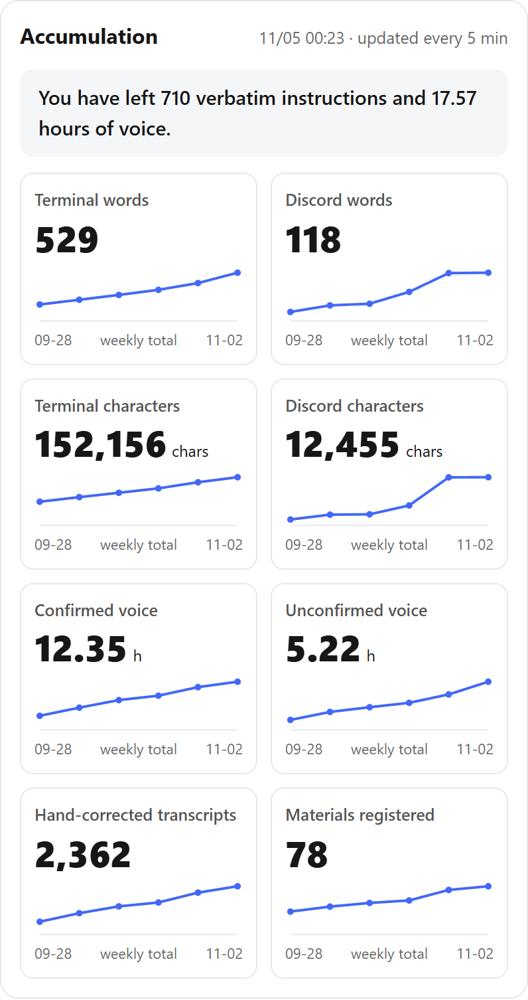
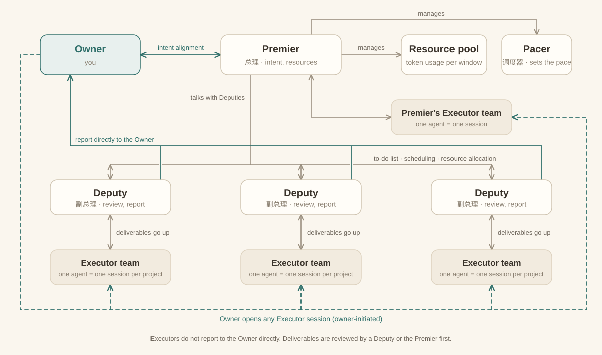
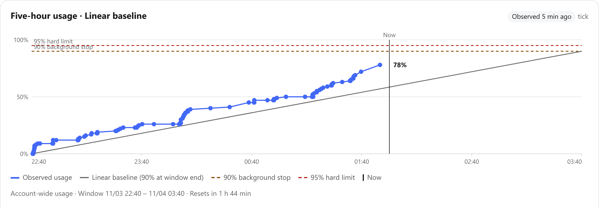
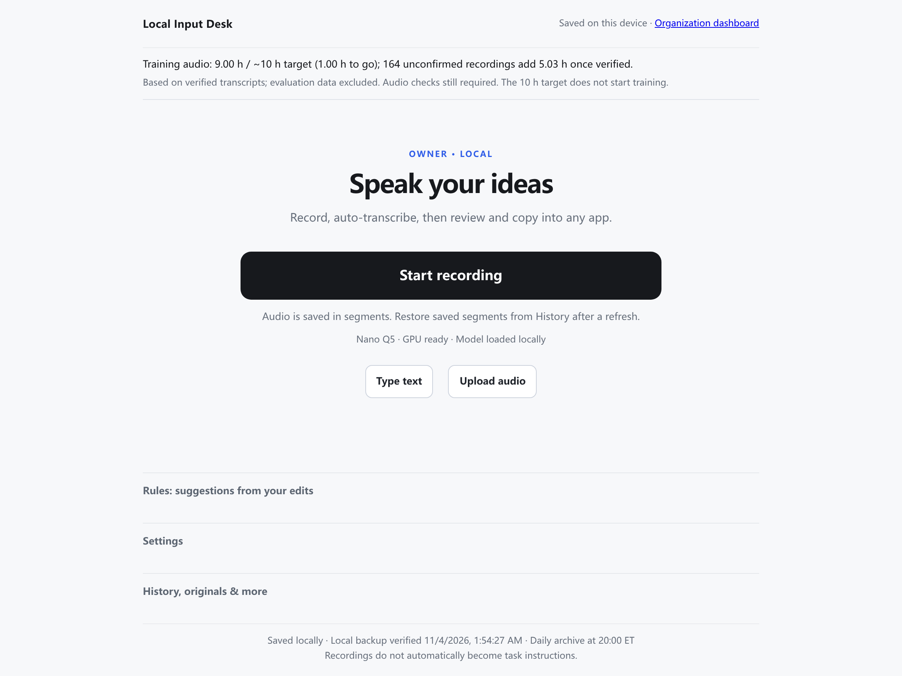

# You Need a Premier

English | [Chinese](README.zh-CN.md)

Let AI's execution catch your creativity. Align intent with the AI once, and the Premier keeps your own AI organization running your projects.

**Start:** make a folder, open Claude Code in it, paste [one prompt](#quick-start).

## When to use it

Use it when you have more ideas and projects than you can execute yourself, and you work with AI agents.

1. **It runs for the long term on its own.** After one intent-alignment session, it keeps running autonomously.
2. **It catches your new ideas.** It picks up and executes a new idea of yours at any time, and schedules resources sensibly while doing so.
3. **It reports at the key points.** When a task reaches a key node, the AI reports to the Owner (you) on its own and asks for your feedback.
4. **Your data is not wasted.** Your verbatim words, the information you provide and the private data you produce are all archived. This data is valuable.

   

   *The Accumulation panel on the org dashboard, a real screenshot (excerpt, labels translated): your words, voice and materials, counted week by week.*

## Org structure



- **Top layer:** the Owner (you), the Premier, the resource pool and the Pacer. The Premier aligns intent with the Owner, manages the resource pool and the Pacer, and has its own Executor team.
- The Premier talks with the Deputies, and coordinates the work of every line through the to-do list, scheduling and resource allocation.
- Each Deputy manages its own Executor team, reviews deliverables and reports. A Deputy can talk with the Premier and can report directly to the Owner.
- Executors normally do not report to the Owner directly. A deliverable is reviewed by a Deputy or the Premier first, and only then reported to you.
- You can open any Executor session at any time and talk to it directly. You start that channel yourself (the dashed line).

## Key designs

Each design answers one bottleneck that appears when a person and AI work together.

| Design | What it does | Bottleneck it addresses |
|---|---|---|
| **Premier** | Resource coordination and intent alignment | Planning and resource management |
| **Deputy** | Reviews deliverables and reports to the Owner (you) | Review: a person lacks the time and energy to review everything the AI produces |
| **Pacer** | Starts tasks according to token usage over a window; speeds up or slows down | Pace adjustment: watching how much quota is left and adjusting your own speed is a mental burden |
| **Executor** | The agent that does the task. One agent = one session, one dedicated agent per project | Managing and isolating context and memory |
| **Org board** (not in v0.1) | One place to see the whole organization | Finding the entry point to information: in a complex system with many files, just knowing where to look is hard |
| **Voice input desk** (not in v0.1) | Rules plus a small model post-process and polish what you say; it adapts to your language habits and accent. Built on open-source models, see below | Entering instructions, especially long ones |
| **History Keeper** (not in v0.1) | Records everything you input and every piece of information you produce | Valuable for a personal benchmark and for training personal models |

### The Pacer

The Pacer spends quota on a time rhythm and keeps a share for you, so the system does not burn everything the moment quota is available. You can step in at any time. Even near the end of a quota window, when little is left, you only wait a little: once the window resets there is quota again.



*A real five-hour window: account-wide usage against the Pacer's linear baseline (the straight line). While usage is above the line, no new task starts; tasks already running and your own sessions still count, so the curve can stay above it. The share kept for you above 95% is never used. Personal text removed.*

### Voice input desk: built on open-source models

The voice input desk runs locally on open-source models. Speech to text: [Fun-ASR-Nano-2512](https://huggingface.co/FunAudioLLM/Fun-ASR-Nano-2512) from [FunASR](https://github.com/modelscope/FunASR), the Q5_K_M quantization in GGUF format. Post-processing and polish: [Qwen3-0.6B](https://huggingface.co/Qwen/Qwen3-0.6B), served by a local [llama.cpp](https://github.com/ggml-org/llama.cpp) `llama-server`. Thanks to these projects.

**Automatic rule suggestions.** When you correct the same misheard phrase in two or more sessions, the desk proposes a "heard → corrected" rule, only if applying it would have wrongly changed nothing else you wrote. Accept it with one click (rules can be deleted or switched off), and that mistake stops coming back.



*The voice input desk, a real screenshot. Personal information removed.*

## Optional modules (not in v0.1)

| Module | Use |
|---|---|
| **Discord** | A cross-platform channel. Configure it to work with the system from your phone. Can be swapped for Slack or Teams. |
| **Email** | Similar to Discord. |
| **Tailscale** | Connects your devices, like a personal VPN. For example, view the org board from another computer. |
| **Colab CLI** | GPU access. If your local GPU is not enough, light tasks can run on Colab's GPU. |
| **Google Drive** | Backup, and file transfer between devices. |

## Recommended models (not required)

| Role | Model |
|---|---|
| Premier and Deputy | Opus 5.5 High |
| Executor | Sonnet 5.5 High |

## Quick start

### Option A: paste one prompt (simplest)

1. Make a folder just for this organization, for example `my-org`.
2. Put in it the projects and files you want it to run (copies, or a note pointing to where a project lives).
3. Open Claude Code in that folder and paste the prompt below.

Claude reads everything first, shows what it found, then asks only what it could not infer. It also offers to clone this repo and reuse what is already built; decline and it builds from the design instead (more of your tokens, more control).

<details>
<summary><b>Show the prompt</b> (copy the whole block)</summary>

<!-- prompt:start -->
```text
You are now my "Premier". In the current folder, help me build a small AI team so the projects here keep moving when I am not watching. Structure: me (the Owner), the Premier (you), Deputies, Executors, plus an automatic scheduler (the Pacer). Reply in English.

Read all the requirements below first, then work step by step. After each step, tell me in a few sentences what you did, how you checked it, and what you need from me next. Wait for my go-ahead before continuing.

[Step 1: read first, do not interview me]
This folder holds the projects and existing files I want the team to run. Read it quietly: each subfolder's README and docs, git repositories (branches, recent commits), notes and materials. If a note points to a path elsewhere, follow it and read that too. Read only: change, delete and move nothing.
Then show me at most 10 lines: which projects you found and your guess of what each one is meant to become. I only need to say "right" or point out what is off.

[Step 2: ask whether to reuse what already exists]
Ask me one question: should you clone https://github.com/Wonderfon/you-need-a-premier into a subfolder of this folder and reuse the parts already built there (guided setup, task board, review step, Pacer, offline rehearsal)?
- Yes: git clone into a subfolder (not inside my projects), read its README.md and docs/ first, build the way it does, and fill in only what is missing. Treat the requirements below as a cross-check.
- No: build it yourself from the design below. This costs me more tokens, but I keep full control and more flexibility.
Continue only after I choose.

[Step 3: configure]
Configure from what you read, and ask only what you could not infer. One question at a time; each question comes with a default you guessed from the folder, and "ok" from me accepts it. At most 5 questions. Candidates (skip any you can already answer):
1. How the projects group into "lines" (one Deputy per line), each line's share of quota, which matters most.
2. My operating system, my Claude subscription, and whether background scheduled runs are acceptable.
3. What must be asked first: spending money, contacting people, publishing, deleting, changing direction, anything else.
4. When and how I want reports, and the hours not to disturb me at night.
Save every word I say verbatim in records/, with a timestamp. Do not paraphrase. For each project write a one-page intent card: only my still-valid words, with date and source; struck through if I overruled them, naming the sentence that overruled them. Show the cards for my confirmation.

[Org structure]
- Premier (you): owns intent, resource allocation and key acceptance. Coordinates, never does the hands-on work. Every 8 hours, review: check each line's progress and spend, adjust shares, and gather what needs my decision.
- Deputy: one per line. Turns my intent into task rows, accepts Executors' deliverables, writes my reports. The acceptance standard is "try it for me": if it fits my intent and is usable as is, pass it, even if imperfect; log small flaws as follow-up tasks instead of nitpicking.
- Executor: the agent that does the work. One fixed session per project (record the session id, continue with --resume), so context is isolated per project. Executors do not report to me directly; a Deputy accepts first.
- I can open any session at any time and talk to it directly.

[Key designs]
1. Intent alignment: read the intent card before writing a task, starting work or accepting a result. A task that does not match the card is not scheduled.
2. Review gate: a deliverable passes a Deputy before I see it. Only three verdicts: pass, rework (say what to change), blocked. Track first-pass rate per Executor.
3. Pacer: spend quota on a time rhythm, not all at once. Draw a straight line from 0 to 95% across the 5-hour window; when usage is above the line, start no new task; the top 5% is always mine. First find a reliable way to read subscription usage on this computer; if you cannot, do not run unattended, and use my "at most N runs per 5 hours" instead. A reading you cannot get is unknown, never 0.
4. One Executor session per project; compact a long session before continuing. After two reworks in a row, start a fresh session, and before that have the old one write what it learned to lessons/<project>.md.
5. History keeping: every instruction I give and every material I provide goes verbatim into records/, append only.
6. Proactive reports: tell me when a deliverable passes and when something needs my decision. Send two fixed daily reports: what I must do first, what I should know, within one screen, with a command that opens the files.
7. How to ask me: write each decision as "waiting for you" with options A, B, C and what each does, then your recommendation and why only I can decide. Silence is not consent; never write "if no reply, default". Before asking, check records/ for whether I already answered.
8. Never idle: when a line has no to-dos, its Deputy adds tasks from a candidate pool, only free, local, reversible ones.
9. Failure cap: at most three different approaches to one problem, then one targeted search; if still stuck, stop and put the evidence in the result file.
10. Code changes only on git branches claude/<topic>, one git worktree per task; never edit the default branch directly, never push; give me merge commands to paste.

[Files (plain text so I can open them)]
README.md (how to use, stop, recover); backlog.md (the task board: one section per line, first line "Weight: NN%", one row per task "- [status] project: task and acceptance criteria", statuses todo, running, review, done, blocked: waiting for you, blocked: waiting for Premier); roles/ (three role descriptions); intent/<project>.md; records/; audits/ (results and review notes, conclusion first); lessons/; pools/; control/tick.py (the scheduler, Python standard library only, parameters in a CONFIG block at the top).

[Scheduler]
Every 5 minutes: read usage and check the pace line; if it fails, start nothing. Read backlog.md, pick lines by "(7-day spend + 1) / weight" from lowest, one todo row per line. Start the Executor with claude -p and --resume (sonnet) and record the cost. When done, set the row to review and start the Deputy (opus) to accept it; the Deputy's last line is "VERDICT: pass / rework / blocked", and the scheduler sets the status from it. Every 8 hours start a Premier review. Every run goes into runs.jsonl. Lock backlog.md and back it up before editing; one task per session at a time.

[Boundaries (always on)]
- No paid APIs, no purchases, no contacting anyone on my behalf.
- Never read or print passwords, keys, tokens or .env files.
- Ask me before creating scheduled tasks, changing system settings or changing permissions.
- Show me the list before deleting any file.
- Never push to a remote, never publish.

[From step 4: build]
4. Create the file structure and the three role descriptions; show me.
5. Write tick.py with a "rehearsal mode": no real Claude calls, a fake task walks one full round (pick a row, execute, accept, change status, write the log), with tests.
6. Run one real small task by hand, for real.
7. After I confirm, wire the scheduled run: ask me which way first (Windows Task Scheduler or macOS launchd) and tell me how to pause and how to stop.
8. Last, add a read-only org board: a local web page showing each line's tasks, what waits for my decision, spend and first-pass rate.
```
<!-- prompt:end -->

Same text as [`prompts/quick-setup.md`](prompts/quick-setup.md).

</details>

### Option B: guided setup script

1. Configure the modules you need.
2. Do one intent alignment with the Premier. This repo's entry point is `python bootstrap.py`, which starts the Premier's interview in the official Claude Code CLI (Python 3.11+, standard library only; see [guided setup](docs/guided-setup.md)).
3. Put your existing files in.
4. The system starts working automatically.

## Status

This repo is v0.1. What it ships today: the guided intent-alignment setup, the plain-text task board, a separate reviewer step, the Pacer's usage gate, and an offline rehearsal. The org board, voice input desk, History Keeper, the optional-module wiring and restoring a whole organization from a backup on a new computer are the design described above and are not in this package yet.

More: [offline demo](docs/offline-demo.md) · [real workers](docs/real-workers.md) · [file map](docs/layout.md) · MIT license
