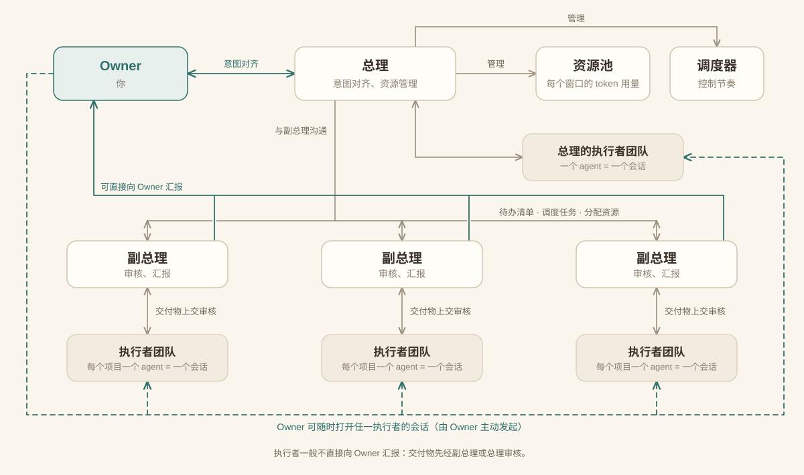
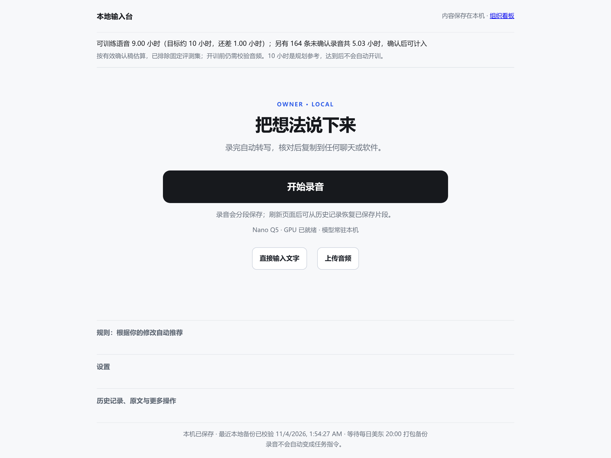

# 你需要一个总理 (You Need a Premier)

[English](README.md) | 简体中文

让 AI 的执行力接住你的创造力。和 AI 做一次意图对齐，总理会让你专属的 AI 组织自动运转你的项目。

**极简上手：**建一个文件夹，在里面打开 Claude Code，粘贴[一段提示词](#简单教程)。

## 使用场景

当你的想法和项目多过你自己能执行的量，并且你在和 AI agent 一起工作时，可以用这个项目。

1. **长期自动运行。** 做一次意图对齐之后，它可以长期自动运行。
2. **接住你的新想法。** 它可以随时接住并执行你的新想法，同时合理调度资源。
3. **关键节点主动汇报。** 在任务推进的关键节点，AI 会主动向 Owner（你）汇报并寻求反馈。
4. **数据不浪费。** Owner 的原话、提供的信息和产生的私有数据都会存档，这些宝贵的数据不会被浪费。

   

   *组织看板「积累」一栏的真实截图（节选）：你留下的原话、语音和资料，按周累计。*

## 组织结构



- **最上层：** Owner（你）、总理，以及资源池和调度器。总理和 Owner 对齐意图，管理资源池和调度器，同时有自己的执行者团队。
- 总理可以跟副总理沟通，也可以通过管理待办清单、调度任务和分配资源，协调各条线上的工作。
- 每个副总理都管理自己的执行者团队，负责审核交付物和汇报，可以跟总理沟通，也可以直接向 Owner 汇报。
- 一般情况下，执行者不直接向 Owner 汇报。交付物要先经过副总理或总理审核，通过后才会报给 Owner。
- 不过，Owner 可以随时打开执行者的会话，直接跟它对话。这个渠道由 Owner 主动发起（图中虚线）。

## 关键设计

每个设计都对应一个人和 AI 一起工作时遇到的瓶颈。

| 设计 | 作用 | 对应的瓶颈 |
|---|---|---|
| **总理** | 负责资源协调和意图对齐 | 规划和资源管理 |
| **副总理** | 审核交付物，并向 Owner（你）汇报 | 审核：人没有足够的时间和精力去审核所有产出 |
| **调度器** | 根据一段时间内的 token 使用情况启动任务，自动加快或放慢节奏 | 节奏调整：人自己用 AI 时要时刻关注还剩多少额度，再调整使用速度，这也是一种心理负担 |
| **执行者**（执行任务的 agent） | 一个 agent 对应一个会话，每个项目有一个专门的 agent | 上下文和记忆的管理与隔离 |
| **组织看板**（v0.1 未包含） | 看整个组织的入口 | 找信息入口：在复杂的系统里，积累了很多信息和文件之后，光是找到从哪里看、去哪里找，就会很费劲 |
| **语音输入台**（v0.1 未包含） | 用规则和小模型做后处理和润色，也会适应个人的语言习惯和口音。基于开源模型，见下 | 输入指令，尤其是长指令 |
| **历史存档**（v0.1 未包含） | 记录 Owner 的所有输入，以及 Owner 产生的信息 | 这些数据很有价值，以后可以用来做个人基准测试，也可以用来训练个人模型 |

### 调度器

调度器的设计很重要的一点是，它给人留出了随时介入的空间。系统会按时间节奏消耗额度，留出一部分给人用，避免一有额度就全部烧完。即使快到额度窗口结束时，剩余额度已经很少，如果不够用，人也只需要稍微等一下，窗口一重置就又有额度了。


*真实的一个五小时窗口：全账户用量与调度器的线性基线（直线）。用量在线上方时不启动新任务；已经在跑的任务和你自己的会话照样计入，所以曲线可以一直在线上方。95% 以上留给你，不会被动用。已去掉个人信息。*

### 语音输入台：基于开源模型

语音输入台在本地运行开源模型。语音转文字：[Fun-ASR-Nano-2512](https://huggingface.co/FunAudioLLM/Fun-ASR-Nano-2512)（来自 [FunASR](https://github.com/modelscope/FunASR)），使用 GGUF 格式的 Q5_K_M 量化版本。后处理和润色：[Qwen3-0.6B](https://huggingface.co/Qwen/Qwen3-0.6B)，由本地的 [llama.cpp](https://github.com/ggml-org/llama.cpp) `llama-server` 提供服务。感谢这些项目。

**自动推荐规则。** 同一个听错的词，你在两个以上的会话里改成了同一种写法，输入台就会推荐一条「听成→改成」的规则，前提是套用后不会误改你写过的其他内容。点一下接受，规则可以删除或停用，这个错就不会再出现。



*语音输入台的真实截图，已去掉个人信息。*

## 可选模块（v0.1 未包含）

| 模块 | 用途 |
|---|---|
| **Discord** | 跨平台的沟通渠道。如果你想在手机上也能跟系统协作，就可以配置这个模块，也可以换成 Slack 或 Teams。 |
| **邮件** | 用途类似。 |
| **Tailscale** | 用于跨设备连接。比如你想在另一台电脑上看组织看板，就可以像搭个人 VPN 一样，把自己的几台设备连起来。 |
| **Colab CLI** | 解决使用 GPU 的问题。如果本地电脑的 GPU 不够，一些轻量任务可以用 Colab 的 GPU 跑。 |
| **Google Drive** | 可以用来备份，也可以在不同设备之间传输文件。 |

## 推荐模型配置（不是必须）

| 角色 | 模型 |
|---|---|
| 总理和副总理 | Opus 5.5 High |
| 执行者 | Sonnet 5.5 High |

## 简单教程

### 最简单：一段提示词

建一个空文件夹，在里面打开 Claude Code，粘贴这段。它会检查你的机器、替你搭好文件夹结构，并一步一步带你设置好 Premier。

<details>
<summary>提示词（点开）</summary>

```text
我想从这个空文件夹开始，建我自己的 Premier（一个靠纯文本文件运转的 AI 组织）。请一步一步来：每一步开始前，用一两句话告诉我你要做什么，等我说“好”再动手。不要向我要密码、token 或 key；不要登录任何账号、发消息、注册计划任务或花钱。

1. 检查 python（3.12 或更高）、git、claude 是否在 PATH 里（`python --version`、`git --version`、`claude --version`）。缺哪个就停下，告诉我怎么装。
2. 在当前文件夹下新建 `workspace`，把 https://github.com/Wonderfon/you-need-a-premier.git 克隆到 `workspace\incore`（文件夹必须叫 incore），在当前文件夹下建虚拟环境 `venv`，把 `workspace\incore\requirements\input-dashboard.txt` 装进去。
3. 问我的名字。把 `workspace\incore\instance\example\instance.json` 复制成 `workspace\incore\instance\instance.json` 并填好：`workspace` 填 `workspace` 文件夹的完整路径，`user_home` 填当前文件夹下新建的空文件夹 `orghome`，`owner_name` 填我的名字。写文件前先给我看内容。
4. 读 `workspace\incore\docs\start-session.md` 并照着做：一次问我一个问题，写出我的第一张意图卡、我的线、我的项目和第一批任务行，每个文件写之前先给我看。
5. 照 `workspace\incore\docs\start.md` 第 5 步启动看板，给我一条打开它的命令和一条停止它的命令。如果 8765 端口被占用，照 `start.md` 写的换一个端口。
```

</details>

### 或者自己克隆

两条路，挑属于你的那一条。

1. **你是第一次用 Premier。** 克隆本仓库，照 [docs/start.md](docs/start.md) 走。约 30 分钟，最后看板上会出现你的第一个项目。不需要任何账号；Claude Code 由你自己登录。
2. **你已经在跑一个 Premier、有备份，要换一台新电脑。** 照 [docs/restore.md](docs/restore.md) 走。它写给 Claude Code 会话照着做，你只回答几个问题。

## 当前状态

本仓库是 v0.1。这个包里已有：组织看板（`input/`）和 [docs/start.md](docs/start.md)（从全新 clone 带你走到看板显示你的第一个项目）；引导式设置会话（[docs/start-session.md](docs/start-session.md)，写出你的意图卡、线、项目和第一批任务行）；纯文本任务表；独立的审核步骤；调度器的用量闸门（调度器代码在 `control/`，可选：不会替你注册）；在新电脑上从备份恢复（[docs/restore.md](docs/restore.md)）；以及用虚构数据的离线演示（`demo/run_demo.py`）。还不在这个包里：历史存档、开箱即用的语音输入台（语音识别代码在，但没带模型，start.md 也不带你设置它），以及 Discord、邮件、备份的分步设置。

更多：[常见问题](docs/faq.md) · [开始](docs/start.md) · [从备份恢复](docs/restore.md) · [安装约定](docs/install-contract.md) · [控制队列说明](control/README.md) · [MIT 许可证](LICENSE)
