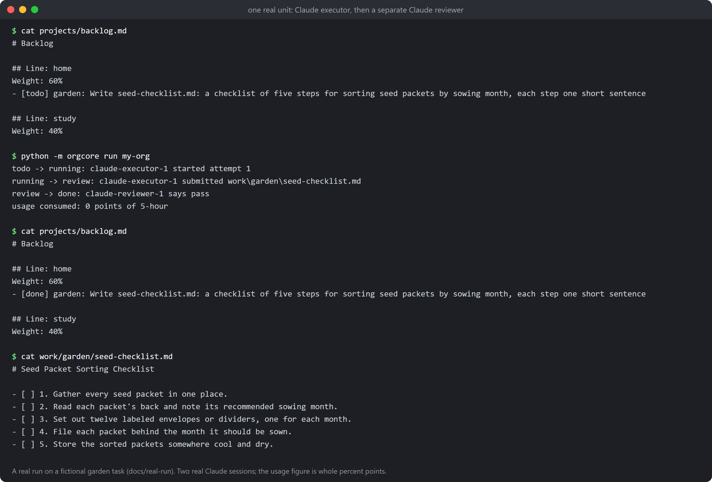

# A real run

Everything above the line was first shown with stub workers, so here is one real unit. On 2026-10-26, on a fictional instance (a "garden" project, set up through the guided setup), the row "Write seed-checklist.md: a checklist of five steps for sorting seed packets by sowing month, each step one short sentence" was run with `python -m orgcore run` on a Claude plan sign-in. No API key, no money.

- **What it produced:** `seed-checklist.md`, five numbered steps, one short sentence each (`docs/real-run/seed-checklist.md`).
- **What the reviewer said:** `pass`, from a separate session with its own identity. It checked the five steps and the one-sentence rule against the row, found no credential, spending or outside claim, and left one small follow-up (step 5, storing the packets, comes after the sort is finished). A trivial task, so there was nothing for the reviewer to catch; an example where it sends work back is the offline rehearsal below.
- **How much allowance it used:** the whole unit, executor and reviewer, took about 20 seconds, and the 5-hour window read 1% used before and 1% after. The status data reports whole percent points, so the run is recorded as "0 points, measured"; the cost is somewhere under one point. Larger tasks will show a larger figure.
- **Files:** `docs/real-run/` has the board before and after, the command output and the produced file; `tools/make_screenshots.py` draws the picture from them.

This is one small task, not evidence about quality on real work.
